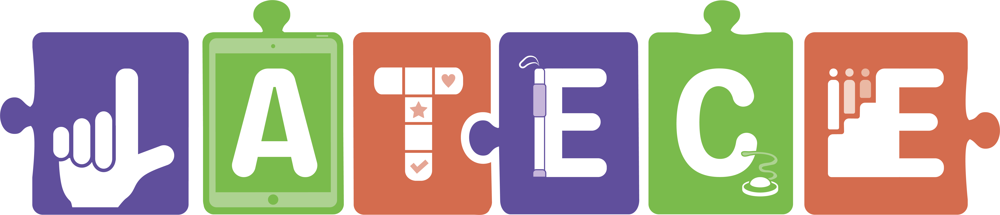
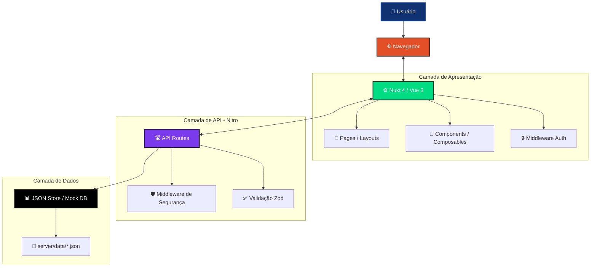

# Portal LATECE — Arquitetura Nuxt 4

<p align="center">
  
</p>

<h1 align="center">Portal LATECE</h1>

<p align="center">
  <strong>Laboratório de Tecnologia Assistiva</strong><br>
  <em>Universidade Federal do Rio Grande do Norte — UFRN</em>
</p>

<p align="center">
  <a href="https://github.com/LATECE-UFRN/latece-site"></a>
  <a href="https://latece-ufrn.github.io/latece-site/"></a>
</p>

<p align="center">
  
  
  
  
  
  
  
  
</p>

<p align="center">
  <em>Promovendo inclusão e acessibilidade através da pesquisa, inovação e formação humana.</em>
</p>

<hr>

<div align="center">

## 📑 Sumário

</div>

<table>
<tr>
<td valign="top" width="50%">

**📖 Visão Geral**
- [Sobre o Portal](#-sobre-o-portal)
- [Objetivos do Projeto](#-objetivos-do-projeto)
- [Funcionalidades](#-funcionalidades)
- [Destaques Recentes](#-destaques-recentes)

**♿ Acessibilidade**
- [Acessibilidade Geral](#-acessibilidade-geral)
- [Recursos Assistivos](#-recursos-assistivos)

**🎨 Design**
- [Identidade Visual](#-identidade-visual)
- [Paleta de Cores](#-paleta-de-cores)
- [Tipografia](#-tipografia)

</td>
<td valign="top" width="50%">

**🏗️ Arquitetura**
- [Arquitetura Técnica](#️-arquitetura-técnica)
- [Estrutura de Diretórios](#-estrutura-de-diretórios)
- [Camadas da Aplicação](#-camadas-da-aplicação)
- [Sistema de Dados](#-sistema-de-dados)

**🌐 Produção**
- [Infraestrutura e Deploy](#-infraestrutura-e-deploy)
- [Segurança](#-segurança)

**🛠️ Desenvolvimento**
- [Instalação Local](#-instalação-local)
- [Manutenção](#-manutenção)
- [Roadmap](#-roadmap)

</td>
</tr>
</table>

<hr>

## 🌐 Sobre o Portal

O **Portal LATECE** é o website institucional do Laboratório de Tecnologia Assistiva do Centro de Educação da Universidade Federal do Rio Grande do Norte (UFRN). Sua missão é divulgar atividades, projetos, equipe e recursos do laboratório, promovendo **inclusão** e **acessibilidade** por meio da Tecnologia Assistiva.

O projeto foi arquitetado com uma **Stack moderna baseada em Nuxt 4 e Vue 3**, aplicando as diretrizes institucionais da STI/UFRN. A aplicação utiliza renderização híbrida (SSR/SPA), uma camada de API interna (Nitro) para servir os dados e um ecossistema de segurança robusto com `nuxt-security` e validação Zod. A interface foi projetada para ser totalmente responsiva, acessível e aderente à identidade visual da UFRN.

<br>

<table>
<thead>
<tr>
<th align="left">🔖 Atributo</th>
<th align="left">📋 Valor</th>
</tr>
</thead>
<tbody>
<tr><td><strong>Nome</strong></td><td>LATECE — Laboratório de Tecnologia Assistiva</td></tr>
<tr><td><strong>Instituição</strong></td><td>Universidade Federal do Rio Grande do Norte (UFRN) — Centro de Educação</td></tr>
<tr><td><strong>Natureza</strong></td><td>Website institucional dinâmico (Nuxt 4)</td></tr>
<tr><td><strong>Repositório</strong></td><td><a href="https://github.com/LATECE-UFRN/latece-site">LATECE-UFRN/latece-site</a></td></tr>
<tr><td><strong>URL de produção</strong></td><td><a href="https://latece-ufrn.github.io/latece-site/">https://latece-ufrn.github.io/latece-site/</a></td></tr>
<tr><td><strong>Stack Principal</strong></td><td>Nuxt 4.6.2 · Vue 3.5 · TypeScript · CSS Puro · Nitro</td></tr>
<tr><td><strong>Hospedagem</strong></td><td>GitHub Pages (estático gerado via <code>nuxt build --preset github_pages</code>)</td></tr>
<tr><td><strong>Segurança</strong></td><td>nuxt-security (CSP) · Zod (Validação) · DOMPurify (Sanitização)</td></tr>
<tr><td><strong>Idiomas</strong></td><td>Português (Estrutura preparada para i18n)</td></tr>
</tbody>
</table>

---

## 🎯 Objetivos do Projeto

<div align="center">

**Objetivo geral.** Disponibilizar um portal institucional que divulgue as atividades, projetos, recursos e a equipe do LATECE, promovendo acessibilidade, inclusão e democratização do conhecimento em Tecnologia Assistiva.

</div>

<br>

<table>
<thead>
<tr>
<th align="left">🎯 Objetivo</th>
<th align="left">📝 Descrição</th>
</tr>
</thead>
<tbody>
<tr><td><strong>Divulgação institucional</strong></td><td>Apresentar missão, visão e histórico do laboratório.</td></tr>
<tr><td><strong>Apresentação da equipe</strong></td><td>Exibir coordenação, técnicos, bolsistas e parceiros com links para Lattes.</td></tr>
<tr><td><strong>Catálogo de equipamentos</strong></td><td>Disponibilizar acervo de recursos de Tecnologia Assistiva com filtros e imagens.</td></tr>
<tr><td><strong>Repositório de publicações</strong></td><td>Listar artigos, teses e demais produções com filtros de busca.</td></tr>
<tr><td><strong>Divulgação de notícias</strong></td><td>Publicar notícias e eventos integrados a um painel administrativo.</td></tr>
<tr><td><strong>Canal de sugestões</strong></td><td>Oferecer formulário validado para contribuições da comunidade.</td></tr>
<tr><td><strong>Acessibilidade e inclusão</strong></td><td>Garantir acesso a todos, independentemente de habilidades ou condições.</td></tr>
</tbody>
</table>

---

## ✅ Funcionalidades

### 🌐 Portal Público

<table>
<thead>
<tr>
<th align="left">Funcionalidade</th>
<th align="center">Estado</th>
<th align="left">Observações</th>
</tr>
</thead>
<tbody>
<tr>
<td><strong>Página Inicial</strong></td>
<td align="center">✅</td>
<td>Hero carrossel acessível, seção de notícias dinâmica, agenda de eventos e missão.</td>
</tr>
<tr>
<td><strong>Sobre o LATECE</strong></td>
<td align="center">✅</td>
<td>Missão, objetivos e informações institucionais.</td>
</tr>
<tr>
<td><strong>Equipe</strong></td>
<td align="center">✅</td>
<td>Agrupamento por função (Cards para coordenação/técnicos, Listas para parceiros).</td>
</tr>
<tr>
<td><strong>Equipamentos</strong></td>
<td align="center">✅</td>
<td>Catálogo dinâmico com filtros de busca, categorias e paginação.</td>
</tr>
<tr>
<td><strong>Publicações</strong></td>
<td align="center">✅</td>
<td>Listagem horizontal com filtros (tipo, ano, autor) e paginação.</td>
</tr>
<tr>
<td><strong>Notícias</strong></td>
<td align="center">✅</td>
<td>Lista com filtros e página de detalhe com sanitização de HTML.</td>
</tr>
<tr>
<td><strong>Sugestões</strong></td>
<td align="center">✅</td>
<td>Formulário conectado à API interna com validação de dados.</td>
</tr>
<tr>
<td><strong>Página 404</strong></td>
<td align="center">✅</td>
<td>Página de erro amigável com redirecionamento.</td>
</tr>
<tr>
<td><strong>Acessibilidade</strong></td>
<td align="center">✅</td>
<td>Skip link, foco visível, ARIA e contraste institucional.</td>
</tr>
</tbody>
</table>

### 🔐 Painel Administrativo (Provisório)

<table>
<thead>
<tr>
<th align="left">Funcionalidade</th>
<th align="center">Estado</th>
<th align="left">Observações</th>
</tr>
</thead>
<tbody>
<tr>
<td><strong>Login</strong></td>
<td align="center">🟡</td>
<td>Autenticação mockada via API interna, com cookie `httpOnly`.</td>
</tr>
<tr>
<td><strong>Dashboard</strong></td>
<td align="center">🟡</td>
<td>Menu de navegação para os módulos administrativos.</td>
</tr>
<tr>
<td><strong>Gerenciar Notícias (CRUD)</strong></td>
<td align="center">🟡</td>
<td>Listagem, criação, edição e exclusão operando em memória (JSON Store).</td>
</tr>
</tbody>
</table>

> **⚠️ Nota importante.** O painel administrativo opera atualmente em memória (Mock/JSON Store) para fins de validação. As alterações não persistem após reiniciar o servidor. A integração com banco de dados PostgreSQL está prevista para a próxima fase de infraestrutura.

---

## ♿ Acessibilidade Geral

<table>
<thead>
<tr>
<th align="left">♿ Recurso</th>
<th align="left">🛠️ Implementação</th>
<th align="center">📊 Status</th>
</tr>
</thead>
<tbody>
<tr><td><strong>Skip link</strong></td><td><code>.skip-link</code> no layout global</td><td align="center">✅ Funcional</td></tr>
<tr><td><strong>Foco visível</strong></td><td><code>:focus-visible</code> com alto contraste</td><td align="center">✅ Funcional</td></tr>
<tr><td><strong>ARIA e Semântica</strong></td><td>Uso rigoroso de <code>header</code>, <code>main</code>, <code>nav</code> e <code>aria-labels</code></td><td align="center">✅ Funcional</td></tr>
<tr><td><strong>Navegação por teclado</strong></td><td>Menu mobile fechado via tecla <code>ESC</code>, foco controlado</td><td align="center">✅ Funcional</td></tr>
<tr><td><strong>Sanitização de HTML</strong></td><td><code>DOMPurify</code> aplicado ao conteúdo das notícias</td><td align="center">✅ Funcional</td></tr>
<tr><td><strong>Respeito a Movimento</strong></td><td>Suporte a <code>prefers-reduced-motion</code></td><td align="center">✅ Funcional</td></tr>
</tbody>
</table>

---

## 🎨 Identidade Visual

A interface foi construída sobre a base do **Design System Institucional da UFRN**, garantindo coesão visual com os demais sistemas da universidade.

### 🎨 Paleta de Cores

<table>
<thead>
<tr>
<th align="left">Função</th>
<th align="center">Cor (HEX)</th>
<th align="left">Uso</th>
</tr>
</thead>
<tbody>
<tr><td><strong>Primária</strong></td><td align="center"><code>#113272</code></td><td>Header, Footer, botões de ação, links e títulos</td></tr>
<tr><td><strong>Primária (Hover)</strong></td><td align="center"><code>#1A4B9C</code></td><td>Estados de interação (hover) de botões</td></tr>
<tr><td><strong>Fundo Global</strong></td><td align="center"><code>#F5F5F5</code></td><td>Áreas externas aos blocos de conteúdo</td></tr>
<tr><td><strong>Superfície</strong></td><td align="center"><code>#FFFFFF</code></td><td>Cards, formulários e <code>main-content</code></td></tr>
<tr><td><strong>Texto Principal</strong></td><td align="center"><code>#333333</code></td><td>Parágrafos e textos corridos</td></tr>
<tr><td><strong>Destaque (Foco)</strong></td><td align="center"><code>#F39C12</code></td><td>Bordas de <code>outline</code> no foco visível</td></tr>
<tr><td><strong>Rodapé</strong></td><td align="center"><code>#D1D5DB</code></td><td>Texto secundário sobre o fundo azul primário</td></tr>
</tbody>
</table>

### 🔤 Tipografia

<table>
<thead>
<tr>
<th align="left">Elemento</th>
<th align="left">Família</th>
<th align="center">Pesos</th>
<th align="left">Escala</th>
</tr>
</thead>
<tbody>
<tr>
<td><strong>Títulos</strong><br><small>Headings, títulos de seção</small></td>
<td><code>'Liberation Sans', sans-serif</code></td>
<td align="center"><code>700</code></td>
<td>Responsiva via CSS</td>
</tr>
<tr>
<td><strong>Corpo</strong><br><small>Texto corrido, parágrafos</small></td>
<td><code>'Liberation Sans', Arial, sans-serif</code></td>
<td align="center"><code>400</code> · <code>500</code></td>
<td>Base: <code>1rem = 16px</code></td>
</tr>
</tbody>
</table>

---

## 🏗️ Arquitetura Técnica

O portal é uma aplicação **full-stack baseada em Nuxt 4**, utilizando a camada de servidor Nitro para intermediar o acesso aos dados.

### 📐 Diagrama de Arquitetura



### 🔄 Fluxo de Carregamento e Dados

```text
┌────────────────────────────────────────────────────────────┐
│  Navegador requisita Rota (ex: /noticias)                  │
│           │                                               │
│           ▼                                               │
│  Nuxt Router processa a página e o Layout global           │
│           │                                               │
│           ▼                                               │
│  Componente Vue executa useFetch('/api/news')              │
│           │                                               │
│           ▼                                               │
│  Nitro Server intercepta a requisição HTTP                 │
│           │                                               │
│           ├── [Middleware] Valida permissões (se aplicável)│
│           ├── [API Handler] Lê os dados                   │
│           └── Retorna JSON com os dados                    │
│           │                                               │
│           ▼                                               │
│  Componente Vue recebe os dados e renderiza                │
│           │                                               │
│           ▼                                               │
│  DOM atualizado + Hidratação (SSR) concluída               │
└────────────────────────────────────────────────────────────┘
```

---

### 📁 Estrutura de Diretórios

```text
latece-site/
│
├── 📄 .github/                     # Workflows de CI/CD
│   └── workflows/
│       └── deploy.yml              # Automação do GitHub Pages
│
├── ⚙️ app/                         # Diretório principal da aplicação Nuxt
│   ├── assets/                     # Recursos processados (CSS, Imagens)
│   │   └── css/
│   │       └── main.css            # Design Tokens e estilos globais
│   ├── components/                 # Componentes Vue reutilizáveis
│   │   ├── HeroCarousel.vue
│   │   ├── HeroSection.vue
│   │   ├── Pagination.vue
│   │   └── AgendaSection.vue
│   ├── composables/                # Lógica reativa reutilizável
│   │   └── useImageUrl.ts          # Resolução de caminhos de imagem (Base URL)
│   ├── layouts/                    # Estruturas de página (Header/Footer)
│   │   └── default.vue
│   ├── middleware/                 # Guardas de rota
│   │   └── auth.ts                 # Protege rotas /admin
│   ├── pages/                      # Roteamento baseado em arquivos
│   │   ├── index.vue               # Home
│   │   ├── sobre.vue
│   │   ├── equipe.vue
│   │   ├── equipamentos.vue
│   │   ├── publicacoes.vue
│   │   ├── noticias/               # Rotas de notícias
│   │   │   ├── index.vue
│   │   │   └── [id].vue
│   │   └── admin/                  # Painel Administrativo
│   │       ├── index.vue
│   │       └── noticias/
│   ├── app.vue                     # Componente raiz
│   └── error.vue                   # Página de erro global
│
├── 🖥️ server/                      # Camada Backend (Nitro)
│   ├── api/                        # Endpoints da API
│   │   ├── auth/                   # Autenticação
│   │   ├── news/                   # CRUD de Notícias
│   │   ├── team/                   # Rota de Equipe
│   │   ├── equipment/              # Rota de Equipamentos
│   │   ├── publications/           # Rota de Publicações
│   │   └── agenda/                 # Rota da Agenda
│   ├── data/                       # Fonte de dados (JSONs)
│   │   ├── news-fallback.json
│   │   ├── team.json
│   │   ├── equipment.json
│   │   ├── publications.json
│   │   └── agenda.json
│   ├── middleware/                 # Middleware de servidor
│   │   └── auth.ts                 # Proteção de rotas de API
│   └── utils/                      # Utilitários do servidor
│       └── newsStore.ts            # Store em memória para Notícias
│
├── 🖼️ public/                      # Arquivos estáticos servidos na raiz
│   └── images/                     # Imagens do projeto (equipe, notícias, etc)
│
├── ⚙️ nuxt.config.ts               # Configuração do Nuxt (Segurança, CSS, Runtime)
├── 📦 package.json                 # Dependências e scripts
└── 📘 tsconfig.json                # Configuração do TypeScript
```

---

### 🧩 Camadas da Aplicação

<table>
<thead>
<tr>
<th align="left">Camada</th>
<th align="left">Responsabilidade</th>
<th align="left">Tecnologias</th>
</tr>
</thead>
<tbody>
<tr><td><strong>Apresentação (Frontend)</strong></td><td>Renderização das páginas, reatividade, componentes visuais e navegação.</td><td>Nuxt 4, Vue 3, CSS Puro</td></tr>
<tr><td><strong>Comunicação (API)</strong></td><td>Fornecimento de endpoints RESTful, proteção de rotas e formatação de dados.</td><td>Nitro (Server Routes)</td></tr>
<tr><td><strong>Validação (Schema)</strong></td><td>Verificação de tipos e formatos de payloads de entrada (ex: formulários e admin).</td><td>Zod 4</td></tr>
<tr><td><strong>Dados (Store)</strong></td><td>Armazenamento e leitura de dados (atualmente baseado em JSON/em memória).</td><td>JSON (server/data)</td></tr>
<tr><td><strong>Segurança</strong></td><td>Proteção contra XSS, CORS, headers maliciosos e controle de acesso.</td><td>nuxt-security, DOMPurify</td></tr>
</tbody>
</table>

---

## 🔒 Segurança

A aplicação adota as diretrizes do **OWASP Top 10**, focando na proteção de dados e na integridade da aplicação.

<table>
<thead>
<tr>
<th align="left">Aspecto</th>
<th align="left">Implementação</th>
<th align="left">Observação</th>
</tr>
</thead>
<tbody>
<tr><td><strong>Content Security Policy (CSP)</strong></td><td><code>nuxt-security</code></td><td>Restringe origens de scripts, estilos e imagens.</td></tr>
<tr><td><strong>Sanitização de HTML</strong></td><td><code>isomorphic-dompurify</code></td><td>Aplicado em todas as renderizações de conteúdo rico (notícias).</td></tr>
<tr><td><strong>Validação de Dados</strong></td><td>Zod</td><td>Garante que os dados enviados à API estejam no formato esperado.</td></tr>
<tr><td><strong>Proteção de Endpoints</strong></td><td>Middleware server-side</td><td>Rotas de escrita (POST/PUT/DELETE) exigem token.</td></tr>
<tr><td><strong>Cookies Seguros</strong></td><td>Cookie <code>httpOnly</code></td><td>O token de sessão não é acessível via JavaScript no cliente.</td></tr>
<tr><td><strong>Headers de Proteção</strong></td><td>Configurados no Nuxt</td><td><code>X-Content-Type-Options</code>, <code>X-Frame-Options</code>, <code>Referrer-Policy</code>.</td></tr>
</tbody>
</table>

---

## 🌐 Infraestrutura e Deploy

O projeto está configurado para ser entregue como uma aplicação estática (SSG) no **GitHub Pages**, integrando-se à identidade institucional.

### 🚀 Pipeline de Publicação

A publicação é automatizada sempre que há um push na branch `main`, utilizando o **GitHub Actions**.

<table>
<thead>
<tr>
<th align="left">Etapa</th>
<th align="left">Ferramenta</th>
<th align="left">Ação</th>
</tr>
</thead>
<tbody>
<tr><td><strong>1. Build</strong></td><td>GitHub Actions</td><td>Executa <code>npx nuxt build --preset github_pages</code>.</td></tr>
<tr><td><strong>2. Resolução de Base URL</strong></td><td>Variável de Ambiente</td><td>Injeta <code>NUXT_APP_BASE_URL</code> para corrigir caminhos de imagens e links.</td></tr>
<tr><td><strong>3. Artifact</strong></td><td>GitHub Pages</td><td>Faz o upload da pasta <code>.output/public</code> como artefato.</td></tr>
<tr><td><strong>4. Deploy</strong></td><td>GitHub Pages</td><td>Publica a versão estática no domínio <code>*.github.io</code>.</td></tr>
</tbody>
</table>

> **✅ Nota sobre imagens.** A aplicação possui um composable (`useImageUrl`) que gerencia dinamicamente o caminho das imagens para garantir que funcionem tanto localmente (localhost) quanto na subpasta do GitHub Pages (ex: `/latece-site/images/...`).

---

## 💻 Instalação Local

### 📋 Pré-requisitos

- Node.js v24.x (ou superior)
- NPM v10.x

### 🚀 Passos

```bash
# 1. Clonar o repositório
git clone https://github.com/LATECE-UFRN/latece-site.git
cd latece-site

# 2. Instalar dependências
npm install

# 3. Executar em ambiente de desenvolvimento
npm run dev
```

Acesse **[http://localhost:3000](http://localhost:3000)**.

Para testar o build de produção localmente:
```bash
npm run build
npm run preview
```

---

## 🛠️ Manutenção e Extensão

<table>
<thead>
<tr>
<th align="left">📂 Área</th>
<th align="left">📄 Arquivo Principal</th>
<th align="left">📝 Instruções</th>
</tr>
</thead>
<tbody>
<tr><td><strong>Cores e Temas</strong></td><td><code>app/assets/css/main.css</code></td><td>Tokens centralizados no seletor <code>:root</code>.</td></tr>
<tr><td><strong>Menu e Navegação</strong></td><td><code>app/layouts/default.vue</code></td><td>Links e estrutura do header/footer institucional.</td></tr>
<tr><td><strong>Notícias</strong></td><td><code>server/api/news/</code> e <code>server/utils/newsStore.ts</code></td><td>API CRUD mockada em memória.</td></tr>
<tr><td><strong>Equipe / Equipamentos</strong></td><td><code>server/data/*.json</code></td><td>Dados brutos (fallback) consumidos pela API.</td></tr>
<tr><td><strong>Segurança</strong></td><td><code>nuxt.config.ts</code></td><td>Regras de CSP e HSTS.</td></tr>
<tr><td><strong>Validação de API</strong></td><td><code>server/api/*/*.ts</code></td><td>Schemas do Zod configurados nos endpoints de escrita.</td></tr>
</tbody>
</table>

### ➕ Adicionar uma nova notícia

1. Acesse o Painel Administrativo (`/admin/noticias/nova`).
2. Preencha os campos (Título, Categoria, Resumo, Conteúdo).
3. Ao salvar, a API registra a notícia no store em memória. (Para persistência real, será necessário conectar ao PostgreSQL).

### 🧩 Adicionar um novo componente

1. Crie o arquivo `.vue` dentro de `app/components/`.
2. Importe-o automaticamente em qualquer página (o Nuxt 4 faz auto-import).
3. Estilize utilizando as classes globais ou escopo local.

---

## 🗺️ Roadmap

<table>
<thead>
<tr>
<th align="left">🚀 Funcionalidade</th>
<th align="center">📊 Status</th>
<th align="center">🎯 Prioridade</th>
</tr>
</thead>
<tbody>
<tr><td><strong>Integração com PostgreSQL (Backend Real)</strong></td><td align="center">📋</td><td align="center">Alta</td></tr>
<tr><td><strong>Autenticação Real (SIGAA)</strong></td><td align="center">📋</td><td align="center">Alta</td></tr>
<tr><td><strong>Template Oficial da STI/UFRN</strong></td><td align="center">📋</td><td align="center">Alta</td></tr>
<tr><td><strong>Auditoria Formal de Contraste (Pa11y CI)</strong></td><td align="center">📋</td><td align="center">Média</td></tr>
<tr><td><strong>Integração com VLibras</strong></td><td align="center">📋</td><td align="center">Média</td></tr>
<tr><td><strong>Sistema de Paginação Global</strong></td><td align="center">✅</td><td align="center">Concluído</td></tr>
<tr><td><strong>Formulário de Sugestões conectado à API</strong></td><td align="center">✅</td><td align="center">Concluído</td></tr>
<tr><td><strong>Upload de Imagens (Notícias)</strong></td><td align="center">📋</td><td align="center">Média</td></tr>
</tbody>
</table>

---

## 👥 Créditos e Contato

### 🎓 Coordenação

- **Débora Nunes** (Coordenadora Geral)
- **Katiene Silva** (Vice-Coordenadora)
- **Débora Deliberato** (Coordenadora Científica)

### 💻 Desenvolvimento

- **Marcone Arruda de Almeida** (Desenvolvedor)
- **Maria Eduarda Ferreira de Lima** (Desenvolvedora)
- **Artemisia Kimberlly Marques da Silva** (Desenvolvedora)

### 🤝 Parceiros

<p align="center">
  <strong>UERN</strong> · <strong>UERJ</strong> · <strong>UFRRJ</strong> · <strong>CNPq</strong> · <strong>FINEP</strong> · <strong>CAPES</strong>
</p>

### 📬 Contato

- **E-mail:** [latece@ufrn.br](mailto:latece@ufrn.br)
- **Telefone:** (84) 3342-2270
- **Endereço:** UFRN — Campus Central, Av. Senador Salgado Filho, 3000, Lagoa Nova, Natal/RN — CEP 59078-900
- **Instagram:** [@latece_ufrn](https://www.instagram.com/latece_ufrn/)

<div align="center">
  <br>
  <p>
    <strong>LATECE — Laboratório de Tecnologia Assistiva</strong><br>
    <em>Promovendo inclusão e acessibilidade através da pesquisa, inovação e formação humana.</em>
  </p>
</div>